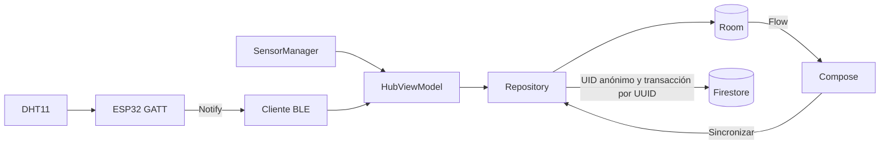
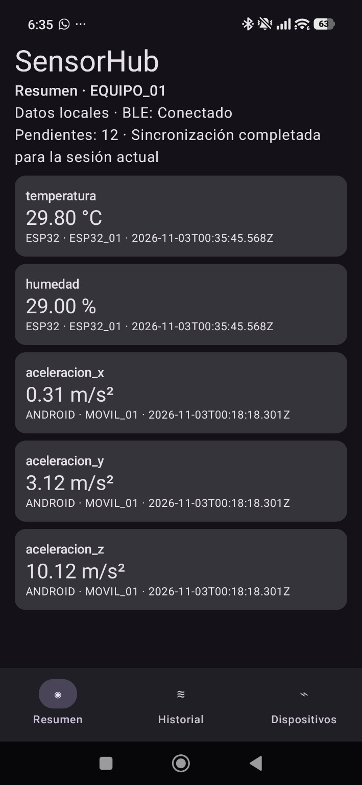
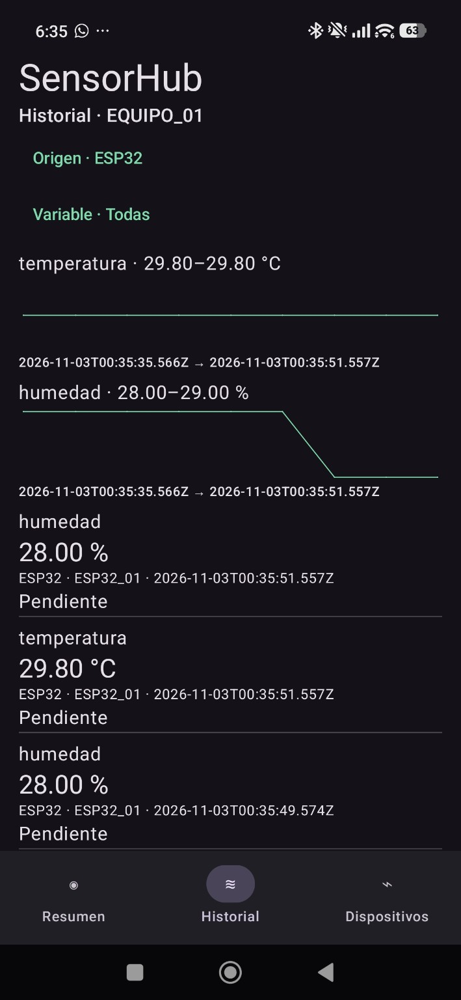
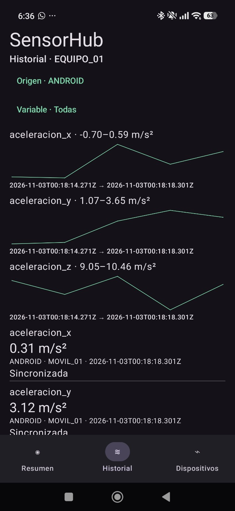
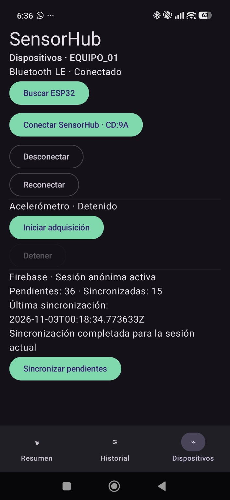
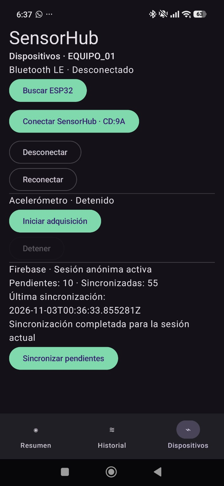
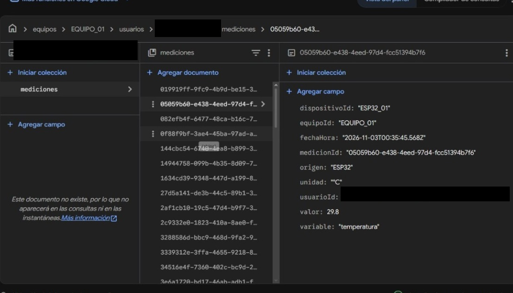

# SensorHub

Proyecto del segundo parcial de Desarrollo de Aplicaciones Móviles. Un teléfono Android registra cinco magnitudes reales, conserva su historial sin Internet y publica las mediciones de su propietario cuando este solicita sincronizar.



## Instalar Android

Abrir la raíz en Android Studio con SDK 37 y la cadena Java indicada por el wrapper de Gradle (daemon JDK 25). La app usa Kotlin, Compose Material 3, Room y Firebase. Admite API 26 en adelante y apunta a API 37. Obtener el archivo de configuración de la app Android autorizada `com.gonzalo.sensorhub` del proyecto Firebase `sensorhub-87cd7` y colocarlo en `app/google-services.json` si falta. Está excluido de Git. La base es `(default)`; el proveedor anónimo y las reglas de propietario deben estar habilitados.

Desde la raíz en PowerShell:

```powershell
.\gradlew.bat :app:assembleDebug :app:testDebugUnitTest
.\gradlew.bat :app:connectedDebugAndroidTest
.\gradlew.bat :app:installDebug
```

Los dos últimos comandos requieren un teléfono o emulador visible en `adb devices`. En Android 12 o posterior se pide permiso de dispositivos cercanos. En Android 8–11 se necesita permiso de ubicación y puede ser necesario activar ubicación para obtener resultados de búsqueda.

## Preparar la ESP32

Con la alimentación desconectada, conectar GND a GND, DATA a GPIO 4 y VCC a 3V3 si el módulo DHT11 de tres pines admite 3,3 V. Verificar el rotulado del módulo y su resistencia de pull-up a 3V3. Se seleccionó ESP32 DevKit WROOM-32 (`esp32dev`), pendiente de cotejar con la placa física.

Con PlatformIO Core, desde la raíz:

```powershell
pio run -d firmware/esp32
pio run -d firmware/esp32 -t upload
pio device monitor -b 115200
```

Conectar la placa por USB para los dos últimos pasos. Si hay varios puertos, indicar el de la placa con `--upload-port COMx` y `--port COMx` en el monitor. El firmware fija espressif32 6.9.0 y usa ESP32 BLE Arduino 2.0.0 incluida en Arduino-ESP32 2.0.17, DHT sensor library 1.4.6 y Unified Sensor 1.1.15.

### Contrato de telemetría

| Elemento | Valor |
|---|---|
| Nombre anunciado | SensorHub-ESP32 |
| Servicio GATT | `e89ba400-b5f4-49bc-a83c-76c54ae84001` |
| Característica Notify | `e89ba400-b5f4-49bc-a83c-76c54ae84002` |
| Descriptor de suscripción | CCCD 0x2902 |

Cada notificación contiene exactamente seis bytes. Los dos primeros identifican versión 1 y dispositivo 1 (`ESP32_01`). Siguen temperatura y humedad, cada una en décimas como entero de 16 bits little-endian. El ejemplo hexadecimal `01 01 FE 00 44 02` representa 25,4 °C y 58,0 %. Cabe en los 20 bytes útiles del MTU ATT mínimo. El firmware lee aproximadamente cada dos segundos, descarta errores y solo notifica con el CCCD habilitado. Al desconectar vuelve a anunciarse. Android verifica tamaño, versión, dispositivo y rangos antes de insertar ambas magnitudes juntas.

## Uso

1. En **Dispositivos**, activar Bluetooth, pulsar **Buscar ESP32**, conceder los permisos y conectar el equipo detectado. La búsqueda dura hasta diez segundos. **Reconectar** usa el último equipo de la sesión.
2. Pulsar **Iniciar adquisición** para registrar el acelerómetro. Se guardan X, Y y Z en m/s² como grupo, como máximo una vez por segundo. El tiempo del evento se convierte del reloj monotónico a UTC. Al salir de primer plano se liberan el listener y GATT. Al volver, iniciar o reconectar según corresponda.
3. **Resumen** muestra la última fila local por variable. **Historial** permite combinar filtros de origen y variable. Cada curva representa hasta 60 muestras consecutivas de una variable, con extremos de tiempo UTC y rango de valores.
4. Sin Internet, seguir registrando y consultar el historial incluso tras cerrar y volver a abrir la app. Con Internet, pulsar **Sincronizar pendientes** y revisar contadores, resultado y última sincronización.

## Código y almacenamiento

- `app/src/main/java/com/gonzalo/sensorhub/MainActivity.kt` contiene las tres pantallas. `HubViewModel.kt` controla la adquisición en primer plano y entrega los eventos al repositorio.
- `ble/BleClient.kt` filtra el escaneo por UUID de servicio y controla conexión, descubrimiento y suscripción GATT.
- `data/Readings.kt` valida y transforma eventos. `data/Measurement.java`, `Measurements.java` y `HubDatabase.java` definen Room v1. El compilador de Room procesa las clases Java con annotationProcessor.
- `data/Repository.kt` inserta grupos, administra la identidad y ejecuta la sincronización fuera del hilo principal.
- `firmware/esp32/` contiene la configuración de PlatformIO y el programa de la placa. Las pruebas JVM y de dispositivo están en `app/src/test/` y `app/src/androidTest/`.

Cada fila tiene UUID estable `medicionId`, `equipoId` (EQUIPO_01), `usuarioId` nullable, `dispositivoId`, `origen`, `variable`, `valor`, `unidad`, `fechaHora` ISO 8601 UTC con milisegundos y `sincronizado`. Las fuentes son ANDROID/MOVIL_01 y ESP32/ESP32_01. Los índices apoyan las consultas por fecha, variable y estado.

## Identidad y sincronización

La app reutiliza la sesión anónima. Una medición conserva el UID actual o, al faltar la sesión, el último UID conocido. Solo las filas sin dueño se asignan al primer UID disponible durante una sincronización. Las filas de otro propietario siguen locales y pendientes. Perder la identidad anónima, por ejemplo al borrar los datos de la app, puede impedir recuperar el historial remoto.

El destino es `equipos/EQUIPO_01/usuarios/{firebaseUid}/mediciones/{medicionId}`. Los documentos tienen los campos de Room salvo el indicador local de sincronización. Según la configuración del examen, las reglas permiten leer y crear solo al propietario, validan identificadores, origen y valor, y prohíben modificar o borrar. La app requiere permiso de lectura del propietario también al consultar una ruta propia aún inexistente.

Una sincronización manual comprueba Internet y autenticación, toma un límite de filas y procesa lotes. Una exclusión mutua evita ejecuciones simultáneas. Una transacción lee antes de crear: si el UUID existe exige igualdad de todo el documento. Un conflicto o denegación interrumpe el envío y conserva las filas pendientes. Si hubo creación remota y se perdió la respuesta, el siguiente intento puede confirmar el documento idéntico. El historial permanece en Room.

## Validación y evidencias del examen

Las pruebas JVM cubren tramas válidas, incompletas y fuera de rango, UUID, transformación de los ejes y decisiones de creación, repetición exacta o conflicto. La prueba instrumentada de Room comprueba filtros, últimas lecturas, pendientes y confirmación con protección de propietario.

**Resultados en Windows.** Gradle completó `:app:assembleDebug :app:testDebugUnitTest :app:assembleDebugAndroidTest` con siete pruebas JVM aprobadas (seis del proyecto y una de plantilla). Room generó las implementaciones del DAO y de la base. La prueba instrumentada se compiló y quedó pendiente de ejecución porque `adb devices` no enumeró dispositivos. La primera compilación detectó incompatibilidad de metadatos entre Firebase Auth y Kotlin 2.2.10. La compilación verificada usa Kotlin y el plugin Compose 2.4.0.

**Firmware compilado.** PlatformIO completó `pio run -d firmware/esp32` para `esp32dev` y generó `firmware.bin`. El enlazador informó 39 052 bytes de RAM y 1 128 613 bytes de flash.

**Resultados funcionales con hardware real.** El responsable del proyecto reportó resultados satisfactorios en las siguientes pruebas del examen. Los resultados de compilación anteriores corresponden al registro técnico previo. Durante la preparación de esta entrega solo se revisaron archivos y documentación.

| Área | Pruebas realizadas satisfactoriamente |
|---|---|
| ESP32 y BLE | Lectura real del DHT11, transmisión de temperatura y humedad, conexión y reconexión con Android. |
| Android y Room | Adquisición del acelerómetro, almacenamiento local, consulta del historial y visualización de gráficas. |
| Sincronización y acceso | Funcionamiento sin Internet, sincronización posterior con Firestore, prevención de duplicados y separación y control de acceso entre usuarios. |

## Evidencias de funcionamiento

### Dashboard Android

La pantalla **Resumen** muestra temperatura (°C) y humedad (%) del DHT11 de la ESP32, junto con la aceleración del teléfono en los ejes X, Y y Z (m/s²). Cada lectura indica su origen y marca de tiempo.



### Historial de mediciones

El historial consulta registros persistidos en Room. Los filtros por origen y variable permiten revisar las gráficas de la ESP32 y del acelerómetro por separado y consultar el estado de sincronización.





### Conectividad BLE

Android recibe las notificaciones de la ESP32 mediante BLE GATT. Desde **Dispositivos**, la opción **Reconectar** permite recuperar el enlace sin reiniciar la aplicación. Las capturas documentan los estados conectado y desconectado por separado. La recuperación del enlace se validó en la prueba funcional reportada.





### Firebase Firestore

La sincronización envía las mediciones pendientes de Room a Firestore. Cada documento conserva el UUID estable de la medición y se guarda bajo el equipo y el usuario correspondientes.

En la captura se ocultó el UID anónimo del usuario para su publicación. El UUID de la medición, la temperatura y la marca de tiempo se conservan visibles.



### Video de demostración

[Abrir el video de demostración de SensorHub](docs/evidences/video/sensorhub-demo.mp4) (MP4, 1 min 20 s).
